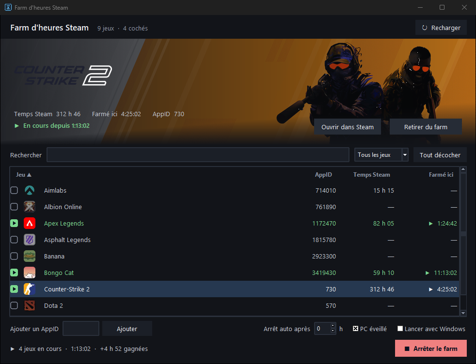

# Steam Hours Farm

A small Windows app that idles your Steam games: Steam thinks the game is running and counts the playtime (trading card drops included), but the game itself never starts. The interface is in French.



## Features

- Lists the games you own. The app reads Steam's local files and asks the Steam client which games you own.
- Shows game icons and banner art from Steam's local cache. Nothing is downloaded.
- Idles up to 32 games at once, the most Steam allows.
- Can stop by itself after a set number of hours, and can keep the PC from going to sleep.
- Keeps running in the system tray when you close the window.
- Can start with Windows: it opens hidden and starts idling the games you checked once Steam is logged in.
- Search, filters (checked, running, never played, installed), a right-click menu, and a "farmed here" counter for each game.

## How it works

Each idled game is a tiny background process. It loads Valve's `steam_api64.dll` with `SteamAppId=<appid>` and calls `SteamAPI_Init`, the same call a real game makes at startup. Steam then shows you as "In game" and counts the time. No game files are run, and nothing is sent to Steam except what that call itself sends.

`steam_api64.dll` is not included in this repository. On first launch, the app copies it from one of the Steam games installed on your PC.

## Install

You need:

- Windows 10 or 11
- the Steam client, running and logged in
- at least one installed Steam game (the app copies `steam_api64.dll` from it)
- [Python 3.10+](https://www.python.org/downloads/) (tick "Add python.exe to PATH") or [uv](https://docs.astral.sh/uv/)

Then:

1. Download this repository (**Code → Download ZIP**) and unzip it.
2. Double-click **`Lancer.bat`**. On first launch it creates a `.venv` folder and installs Pillow and pystray.

To set it up manually instead:

```bat
python -m venv .venv
.venv\Scripts\python.exe -m pip install -r requirements.txt
.venv\Scripts\pythonw.exe farm.py
```

## Good to know

- **Steam counts real time.** One hour of idling adds one hour to each idled game. Nothing can speed that up, but you can idle several games at once.
- **Refunds:** Steam won't refund a game once it has more than 2 hours of playtime. Don't idle a game you might want to refund.
- Your friends will see you as "In game".
- Many players idle games with tools like Idle Master or ArchiSteamFarm, but Valve doesn't officially endorse it. Use this app at your own risk.
- The app keeps your checked games and counters in `config.json`, and errors in `journal.txt`, next to `farm.py`. These files stay on your PC.
- This project is not affiliated with Valve or Steam.

---

## En français

**Farm d'heures Steam** fait tourner tes jeux Steam « à vide ». Steam croit que le jeu est lancé et compte le temps de jeu, ainsi que les drops de cartes, sans que le jeu démarre.

**Installation :** il te faut Windows, Steam ouvert et connecté, au moins un jeu installé et Python 3.10 ou plus récent (ou uv). Télécharge le dépôt (**Code → Download ZIP**), dézippe-le puis double-clique sur **`Lancer.bat`**. Au premier lancement, il installe tout seul ce dont l'appli a besoin.

**Utilisation :**

1. Coche les jeux à farmer : clique sur la case à gauche de leur logo.
2. Clique sur **Démarrer le farm**.
3. Si tu fermes la fenêtre, l'appli se range dans la zone de notification et le farm continue. Clique sur l'icône pour la rouvrir.
4. Avec l'option **Lancer avec Windows**, le farm démarre tout seul à l'allumage du PC.

**À savoir :**

- 1 h de farm donne 1 h sur chaque jeu farmé. On peut farmer jusqu'à 32 jeux en même temps.
- Au-delà de 2 h de jeu, Steam ne rembourse plus le jeu.
- Valve n'autorise pas officiellement cette pratique : c'est à tes risques.

## License

[MIT](LICENSE)
