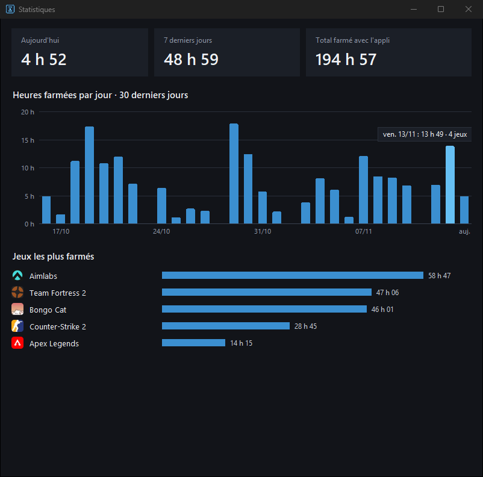

# Steam Hours Farm

A small Windows app that idles your Steam games: Steam thinks the game is running and counts the playtime (trading card drops included), but the game itself never starts. The interface is in French.


## Features

- Lists the games you own. The app reads Steam's local files and asks the Steam client which games you own.
- Shows game icons and banner art from Steam's local cache. Nothing is downloaded.
- Idles up to 32 games at once, the most Steam allows.
- **Hours goal per game:** set a total playtime (say 500 h) and the game leaves the farm by itself once Steam reaches it. When every checked game is done, the farm stops.
- **More than 32 games:** extra games wait in a queue. Every few hours (2 by default) the app swaps the running group for the next one.
- **Steam restarts:** if Steam closes, crashes or updates, the farm pauses and starts again by itself once Steam is back.
- **Refund warning:** a game bought less than 14 days ago with less than 2 hours played triggers a prompt. You can skip it, idle it up to 1 h 50, or idle it anyway.
- **Statistics:** hours idled per day over the last 30 days, and your most idled games.
- **Groups:** save the games you checked under a name and check them all again in one click.
- Can stop after a set number of hours, and can keep the PC from going to sleep.
- Keeps running in the system tray when you close the window.
- Can start with Windows: it opens hidden and starts idling the games you checked once Steam is logged in.
- Search, filters (checked, running, with a goal, refundable, never played, installed) and a right-click menu.



## Install

You need Windows 10 or 11, the Steam client running and logged in, and at least one installed Steam game (the app copies `steam_api64.dll` from it).

### Download the .exe (easiest)

1. Download `SteamHoursFarm-windows.zip` from the [latest release](https://github.com/Dekeur/steam-hours-farm/releases/latest).
2. Unzip it anywhere, for example in your Documents folder.
3. Run `SteamHoursFarm.exe`.

The .exe is not signed, so Windows SmartScreen may say "Windows protected your PC". Click **More info → Run anyway**. If you'd rather not trust a prebuilt file, run it from source or build the .exe yourself (see below).

### Run from source

You also need [Python 3.10+](https://www.python.org/downloads/) (tick "Add python.exe to PATH") or [uv](https://docs.astral.sh/uv/).

1. Download this repository (**Code → Download ZIP**) and unzip it.
2. Double-click **`Lancer.bat`**. On first launch it creates a `.venv` folder and installs Pillow and pystray.

To set it up manually instead:

```bat
python -m venv .venv
.venv\Scripts\python.exe -m pip install -r requirements.txt
.venv\Scripts\pythonw.exe farm.py
```

### Build the .exe yourself

Double-click **`construire_exe.bat`**. It installs PyInstaller in a `.venv-build` folder and writes `dist\SteamHoursFarm\SteamHoursFarm.exe` and `dist\SteamHoursFarm-windows.zip`.

## How it works

Each idled game is a tiny background process. It loads Valve's `steam_api64.dll` with `SteamAppId=<appid>` and calls `SteamAPI_Init`, the same call a real game makes at startup. Steam then shows you as "In game" and counts the time. No game files are run, and nothing is sent to Steam except what that call itself sends.

`steam_api64.dll` is not included in this repository or in the release. On first launch, the app copies it from one of the Steam games installed on your PC.

The refund warning uses the purchase date that the Steam client reports for each game. Free games and games shared through Steam Family are left out.

## Good to know

- **Steam counts real time.** One hour of idling adds one hour to each idled game. Nothing can speed that up, but you can idle several games at once.
- **Refunds:** Steam won't refund a game once it has more than 2 hours of playtime. The app warns you, but the choice is yours.
- Your friends will see you as "In game".
- Each idled game uses about 55 MB of RAM, mostly Steam's own client library.
- Many players idle games with tools like Idle Master or ArchiSteamFarm, but Valve doesn't officially endorse it. Use this app at your own risk.
- The app keeps your checked games, goals, groups and statistics in `config.json`, and errors in `journal.txt`, next to `farm.py` or `SteamHoursFarm.exe`. These files stay on your PC. To update, replace the program files and keep `config.json`.
- This project is not affiliated with Valve or Steam.

---

## En français

**Farm d'heures Steam** fait tourner tes jeux Steam « à vide ». Steam croit que le jeu est lancé et compte le temps de jeu, ainsi que les drops de cartes, sans que le jeu démarre.

**Installation :**

- **Le plus simple :** télécharge `SteamHoursFarm-windows.zip` depuis la [dernière version](https://github.com/Dekeur/steam-hours-farm/releases/latest), dézippe-le et lance `SteamHoursFarm.exe`. Si Windows affiche « Windows a protégé votre ordinateur », clique sur **Informations complémentaires → Exécuter quand même** : le .exe n'est pas signé.
- **Depuis le code :** il te faut Python 3.10 ou plus récent (ou uv). Télécharge le dépôt (**Code → Download ZIP**), dézippe-le puis double-clique sur **`Lancer.bat`**.
- **Construire le .exe toi-même :** double-clique sur **`construire_exe.bat`**.

Dans tous les cas, il faut Steam ouvert et connecté, et au moins un jeu Steam installé.

**Utilisation :**

1. Coche les jeux à farmer : clique sur la case à gauche de leur logo.
2. Clique sur **Démarrer le farm**.
3. Si tu fermes la fenêtre, l'appli se range dans la zone de notification et le farm continue. Clique sur l'icône pour la rouvrir.

**Fonctions :**

- **Objectif d'heures :** dans la bannière du jeu, règle le temps de jeu total à atteindre. Une fois atteint, le jeu sort du farm tout seul.
- **Plus de 32 jeux :** les jeux en trop attendent leur tour. L'appli change de groupe toutes les 2 heures (réglable dans **Options**).
- **Reprise automatique :** si Steam se ferme ou redémarre, le farm se met en pause et repart tout seul.
- **Alerte remboursement :** pour un jeu acheté il y a moins de 14 jours et joué moins de 2 h, l'appli te demande quoi faire : ne pas le farmer, le farmer jusqu'à 1 h 50 ou le farmer quand même.
- **Statistiques :** heures farmées par jour sur 30 jours et jeux les plus farmés.
- **Groupes :** enregistre les jeux cochés sous un nom et recoche-les en un clic.
- **Options :** arrêt automatique après X heures, PC gardé éveillé, lancement avec Windows, ajout d'un jeu par son AppID.

**À savoir :**

- 1 h de farm donne 1 h sur chaque jeu farmé. On peut farmer jusqu'à 32 jeux en même temps.
- Au-delà de 2 h de jeu, Steam ne rembourse plus le jeu.
- Pour mettre à jour l'appli, remplace les fichiers du programme et garde `config.json` : il contient tes jeux cochés, tes objectifs, tes groupes et tes statistiques.
- Valve n'autorise pas officiellement cette pratique : c'est à tes risques.

## License

[MIT](LICENSE)
