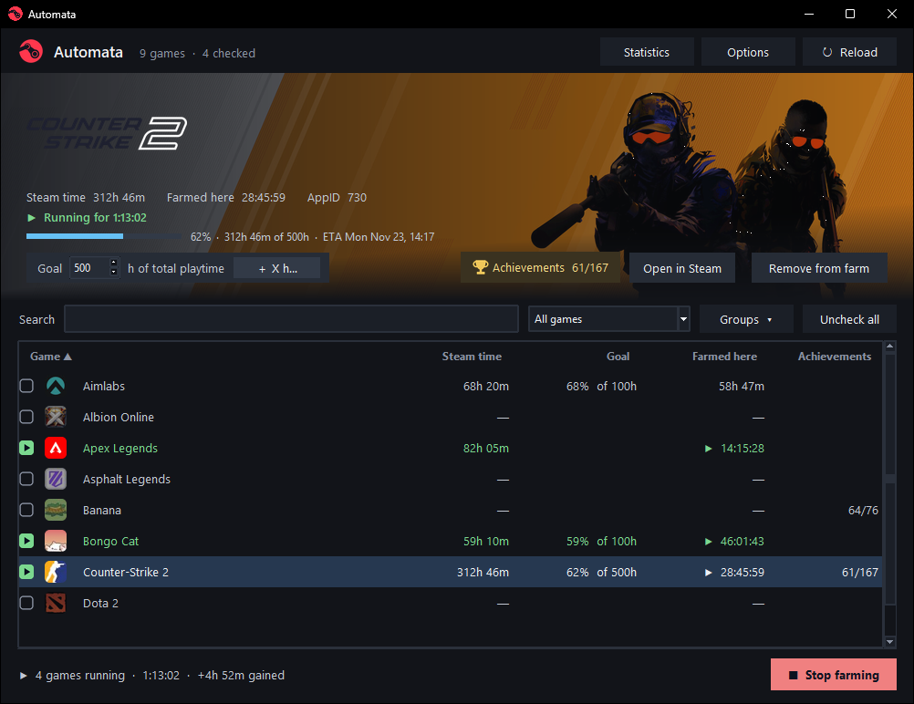
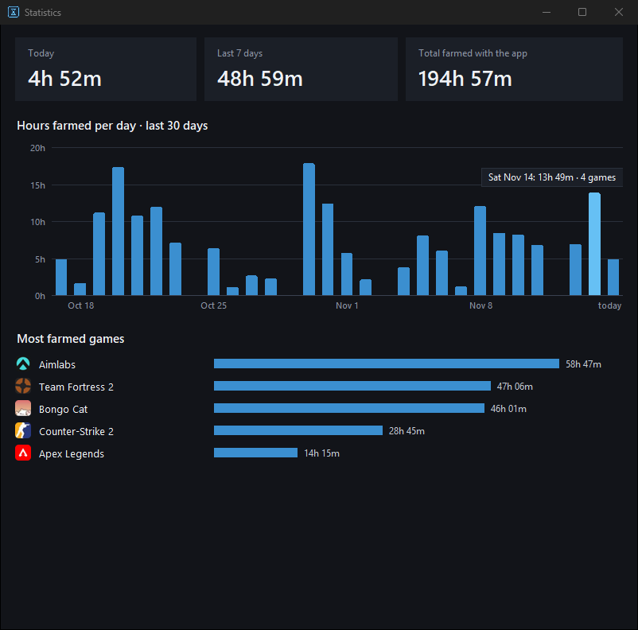
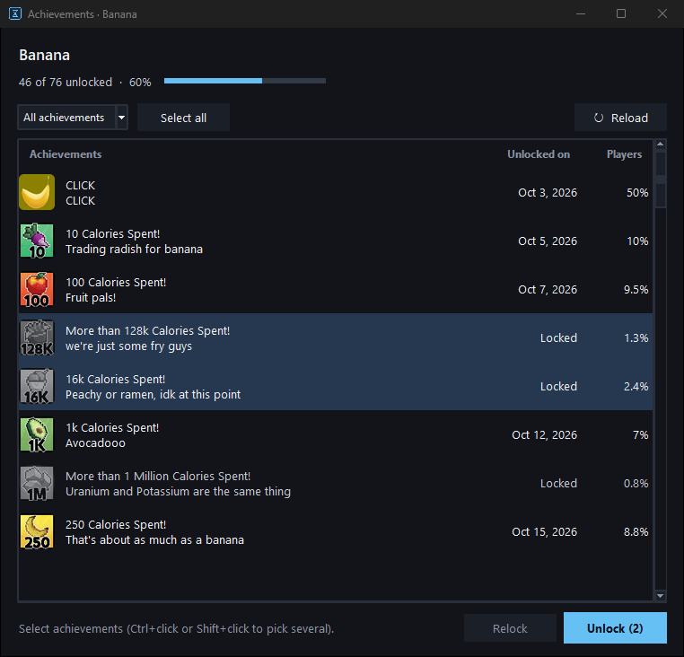
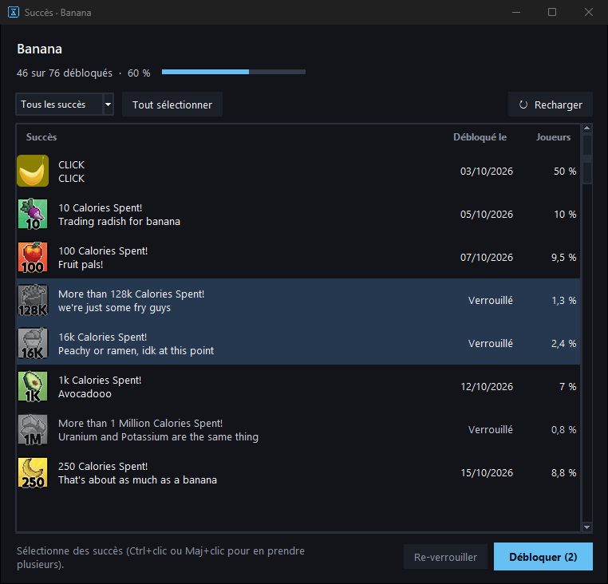

# Automata

*It plays your Steam games for you.*

A small Windows app that idles your Steam games: Steam thinks the game is running and counts the playtime (trading card drops included), but the game itself never starts. The interface is in English or French: you pick the language on first launch and can change it later in Options.



## Features

- Lists the games you own. The app reads Steam's local files and asks the Steam client which games you own.
- Shows game icons and banner art from Steam's local cache. Nothing is downloaded.
- Idles up to 32 games at once, the most Steam allows.
- **Hours goal per game:** set a total playtime (say 500 h) and the game leaves the farm by itself once Steam reaches it. The banner shows when it should get there. **+ X h** sets the goal to the current playtime plus a few hours. When every checked game is done, the farm stops.
- **More than 32 games:** extra games wait in a queue. Every few hours (2 by default) the app swaps the running group for the next one.
- **Pauses while you play:** when you launch a real game, the farm pauses and starts again once you quit it.
- **Steam restarts:** if Steam closes, crashes or updates, the farm pauses and starts again by itself once Steam is back.
- **Only when you're away** (optional): idle only after a few minutes without keyboard or mouse input.
- **Farming hours** (optional): idle only between two times, say 23:00 to 8:00. Outside them the farm pauses and starts again by itself.
- **Invisible mode** (optional): go invisible on Steam while idling, so friends don't see you "In game". Your previous status comes back when the farm stops.
- **Refund warning:** a game bought less than 14 days ago with less than 2 hours played triggers a prompt. You can skip it, idle it up to 1 h 50, or idle it anyway.
- **Statistics:** hours idled per day over the last 30 days, and your most idled games.
- **Groups:** save the games you checked under a name and check them all again in one click.
- **Achievements:** the gold **Achievements** button in the banner (or a right-click on a game) shows the game's achievements with their icons, unlock dates and how many players have them. You can unlock the ones you select, or lock them again (see "Good to know"). The list also has an **Achievements** column (say 12/76) for every game, read from Steam's local cache, and an **Achievements almost done** filter for games where you have at least 80 % of them but not all.
- **Install:** for a game you own but haven't installed, the banner button says **Install** (also in the right-click menu). It opens Steam's own install window.
- **New version notice:** at most once a day, the app asks GitHub whether a newer version is out and shows a link at the top of the window. You can turn it off in Options.
- Can stop after a set number of hours, and can keep the PC from going to sleep.
- Keeps running in the system tray when you close the window, and remembers the window size, its position and how the list is sorted.
- Can start with Windows: it opens hidden and starts idling the games you checked once Steam is logged in.
- Search, filters (checked, running, with a goal, refundable, never played, installed, achievements almost done) and a right-click menu.





## Install

You need Windows 10 or 11, the Steam client running and logged in, and at least one installed Steam game (the app copies `steam_api64.dll` from it).

### Download the .exe (easiest)

1. Download `SteamHoursFarm-windows.zip` from the [latest release](https://github.com/Dekeur/Automata-steam-plugins/releases/latest).
2. Unzip it anywhere, for example in your Documents folder.
3. Run `SteamHoursFarm.exe`.

The .exe is not signed, so Windows SmartScreen may say "Windows protected your PC". Click **More info → Run anyway**. If you'd rather not trust a prebuilt file, run it from source or build the .exe yourself (see below).

### Run from source

You also need [Python 3.10+](https://www.python.org/downloads/) (tick "Add python.exe to PATH") or [uv](https://docs.astral.sh/uv/).

1. Download this repository (**Code → Download ZIP**) and unzip it.
2. Double-click **`Lancer.bat`**. On first launch it creates a `.venv` folder and installs Pillow and pystray.

To set it up manually instead:

```bat
python -m venv .venv
.venv\Scripts\python.exe -m pip install -r requirements.txt
.venv\Scripts\pythonw.exe farm.py
```

### Build the .exe yourself

Double-click **`construire_exe.bat`**. It installs PyInstaller in a `.venv-build` folder and writes `dist\SteamHoursFarm\SteamHoursFarm.exe` and `dist\SteamHoursFarm-windows.zip`.

## How it works

Each idled game is a tiny background process. It loads Valve's `steam_api64.dll` with `SteamAppId=<appid>` and calls `SteamAPI_Init`, the same call a real game makes at startup. Steam then shows you as "In game" and counts the time. No game files are run, and nothing is sent to Steam except what that call itself sends.

`steam_api64.dll` is not included in this repository or in the release. On first launch, the app copies it from one of the Steam games installed on your PC.

The refund warning uses the purchase date that the Steam client reports for each game. Free games and games shared through Steam Family are left out.

A real game is spotted through the "running" flag Steam keeps for each game in the Windows registry. Invisible mode uses Steam's own `steam://friends/status/invisible` link, and reads your previous status from Steam's local settings.

The Achievements window starts the same kind of background process for a few seconds and uses Steam's own achievement calls (`ISteamUserStats`): it reads the list, then `SetAchievement` or `ClearAchievement` and `StoreStats` when you unlock or lock achievements. Nothing is read until you open the window.

The Achievements column reads Steam's local cache (`appcache\stats`): each game's achievement list, and which ones you have. Steam updates it when a game or its library page loads your achievements, so a count can be behind until then. Opening the Achievements window for a game refreshes its count.

The update check is a single request to `api.github.com` for the latest release number, with a generic user agent (`SteamHoursFarm`). It sends nothing about your Steam account, your games or your PC. GitHub sees your IP address, as any website does.

## Good to know

- **Steam counts real time.** One hour of idling adds one hour to each idled game. Nothing can speed that up, but you can idle several games at once.
- **Refunds:** Steam won't refund a game once it has more than 2 hours of playtime. The app warns you, but the choice is yours.
- Your friends will see you as "In game", unless you turn on invisible mode in Options.
- Games idled by another tool (ArchiSteamFarm, for example) look like real games to the app, so it pauses. If you use both, turn off "Pause farming when I launch a real game" in Options.
- Each idled game uses about 55 MB of RAM, mostly Steam's own client library.
- **Achievements:** an unlocked achievement shows on your profile like any other, with the date you unlocked it, and your friends may see it in their activity feed. Ranking sites can spot achievements unlocked all at once, and some games protect theirs (Steam then refuses the change and the app tells you). Opening the window shows you "In game" for a few seconds.
- Many players idle games with tools like Idle Master or ArchiSteamFarm, but Valve doesn't officially endorse it. Use this app at your own risk.
- The app keeps your settings, checked games, goals, groups and statistics in `config.json`, and errors in `journal.txt`, next to `farm.py` or `SteamHoursFarm.exe`. These files stay on your PC. To update, replace the program files and keep `config.json`. The language you pick is also remembered in the registry (`HKEY_CURRENT_USER\Software\FarmHeuresSteam`), so a new version unzipped somewhere else doesn't ask again.
- The app saves `config.json` in a way that can't leave it half-written, and keeps a copy of the last good one in `config.json.bak`. If `config.json` still gets damaged, the app starts from that copy and keeps the damaged file aside instead of overwriting it.
- This project is not affiliated with Valve or Steam.

---

## En français

**Automata** fait tourner tes jeux Steam « à vide ». Steam croit que le jeu est lancé et compte le temps de jeu, ainsi que les drops de cartes, sans que le jeu démarre. L'interface est en français ou en anglais : tu choisis au premier lancement, et tu peux changer ensuite dans **Options**.


**Installation :**

- **Le plus simple :** télécharge `SteamHoursFarm-windows.zip` depuis la [dernière version](https://github.com/Dekeur/Automata-steam-plugins/releases/latest), dézippe-le et lance `SteamHoursFarm.exe`. Si Windows affiche « Windows a protégé votre ordinateur », clique sur **Informations complémentaires → Exécuter quand même** : le .exe n'est pas signé.
- **Depuis le code :** il te faut Python 3.10 ou plus récent (ou uv). Télécharge le dépôt (**Code → Download ZIP**), dézippe-le puis double-clique sur **`Lancer.bat`**.
- **Construire le .exe toi-même :** double-clique sur **`construire_exe.bat`**.

Dans tous les cas, il faut Steam ouvert et connecté, et au moins un jeu Steam installé.

**Utilisation :**

1. Coche les jeux à farmer : clique sur la case à gauche de leur logo.
2. Clique sur **Démarrer le farm**.
3. Si tu fermes la fenêtre, l'appli se range dans la zone de notification et le farm continue. Clique sur l'icône pour la rouvrir.

**Fonctions :**

- **Objectif d'heures :** dans la bannière du jeu, règle le temps de jeu total à atteindre. La bannière indique quand il sera atteint. Le bouton **＋ X h** fixe l'objectif au temps actuel plus quelques heures. Une fois l'objectif atteint, le jeu sort du farm tout seul.
- **Plus de 32 jeux :** les jeux en trop attendent leur tour. L'appli change de groupe toutes les 2 heures (réglable dans **Options**).
- **Pause quand tu joues :** si tu lances un vrai jeu, le farm se met en pause et reprend quand tu le quittes.
- **Reprise automatique :** si Steam se ferme ou redémarre, le farm se met en pause et repart tout seul.
- **Seulement quand tu n'es pas là** (option) : le farm ne tourne qu'après quelques minutes sans clavier ni souris.
- **Plage horaire** (option) : le farm ne tourne qu'entre deux heures, par exemple de 23 h à 8 h. En dehors, il se met en pause et reprend tout seul.
- **Mode invisible** (option) : tu passes en invisible sur Steam pendant le farm, et ton statut d'avant revient à l'arrêt.
- **Alerte remboursement :** pour un jeu acheté il y a moins de 14 jours et joué moins de 2 h, l'appli te demande quoi faire : ne pas le farmer, le farmer jusqu'à 1 h 50 ou le farmer quand même.
- **Statistiques :** heures farmées par jour sur 30 jours et jeux les plus farmés.
- **Groupes :** enregistre les jeux cochés sous un nom et recoche-les en un clic.
- **Succès :** bouton doré **Succès** dans la bannière, ou clic droit sur un jeu. Tu vois les succès du jeu avec leur icône, leur date de déblocage et la part des joueurs qui les ont. Tu peux débloquer ceux que tu sélectionnes, ou les re-verrouiller. La liste a aussi une colonne **Succès** (par exemple 12/76) pour tous tes jeux, lue dans le cache local de Steam, et un filtre **Succès presque finis** : les jeux où tu as au moins 80 % des succès, sans les avoir tous.
- **Installer :** pour un jeu que tu possèdes sans l'avoir installé, le bouton de la bannière devient **Installer** (aussi dans le clic droit). Il ouvre la fenêtre d'installation de Steam.
- **Nouvelle version :** une fois par jour au plus, l'appli demande à GitHub si une version plus récente est sortie et affiche un lien en haut de la fenêtre. Tu peux couper ça dans **Options**.
- **Options :** arrêt automatique après X heures, PC gardé éveillé, plage horaire, lancement avec Windows, langue, avertissement de nouvelle version, ajout d'un jeu par son AppID.
- L'appli retient la taille et la position de la fenêtre, et le tri de la liste.




**À savoir :**

- 1 h de farm donne 1 h sur chaque jeu farmé. On peut farmer jusqu'à 32 jeux en même temps.
- Au-delà de 2 h de jeu, Steam ne rembourse plus le jeu.
- Un succès débloqué avec l'appli apparaît sur ton profil comme les autres, avec la date du déblocage, et tes amis peuvent le voir dans leur fil d'activité. Des sites de classement repèrent les succès débloqués tous d'un coup, et certains jeux protègent les leurs : Steam refuse alors le changement et l'appli te le dit. Ouvrir la fenêtre Succès te met « En jeu » quelques secondes.
- La colonne Succès vient du cache de Steam : un compte peut avoir du retard tant que le jeu, ou sa page dans la bibliothèque, n'a pas rechargé tes succès. Ouvrir la fenêtre Succès d'un jeu remet son compte à jour.
- Pour savoir s'il y a une nouvelle version, l'appli envoie une seule requête à GitHub, sans ton compte Steam, ni tes jeux, ni rien sur ton PC. GitHub voit ton adresse IP, comme n'importe quel site.
- Un jeu farmé par un autre outil (ArchiSteamFarm par exemple) compte comme un vrai jeu et met le farm en pause. Si tu utilises les deux, décoche « Mettre le farm en pause quand je lance un vrai jeu » dans **Options**.
- Pour mettre à jour l'appli, remplace les fichiers du programme et garde `config.json` : il contient tes réglages, tes jeux cochés, tes objectifs, tes groupes et tes statistiques. La langue choisie est aussi retenue dans le registre (`HKEY_CURRENT_USER\Software\FarmHeuresSteam`) : une nouvelle version dézippée ailleurs ne la redemande pas.
- L'appli enregistre `config.json` sans risquer de le laisser à moitié écrit, et garde une copie de la dernière version lisible dans `config.json.bak`. Si `config.json` est quand même abîmé, elle repart de cette copie et met le fichier abîmé de côté au lieu de l'écraser.
- Valve n'autorise pas officiellement cette pratique : c'est à tes risques.

## License

[MIT](LICENSE)
